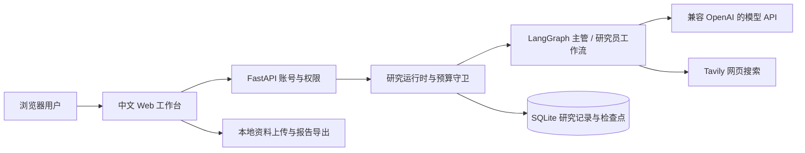

# 深研：LangChain Open Deep Research 本地版

一个面向个人研究的中文 DeepResearch Web 应用。项目基于 [LangChain Open Deep Research](https://github.com/langchain-ai/open_deep_research) 的主管 / 研究员工作流，重点补充了计划确认、多用户凭证隔离、任务预算、SQLite 检查点恢复和报告交付。

## 项目概览

用户先检查并确认研究计划，再启动多阶段研究；网页检索和用户上传资料进入研究流程，最终生成带来源链接的报告。工程侧重点是给长任务加上用户隔离、预算约束、进度持久化和可恢复状态。



**主要工程实现**

- 研究计划先生成、后由用户确认，确认前不会开始网页检索。
- 研究过程按账号隔离模型 / 搜索凭证、历史记录和个人额度。
- 单次任务设置时间、模型调用和 token 预算；超限时停止后续调用并保留已收集资料。
- 通过 LangGraph SQLite 检查点保存执行状态，支持中断后继续未完成研究。
- 支持 PDF、DOCX、Markdown、TXT 资料输入，以及报告追问、版本管理和 Markdown / Word / PDF 导出。

**实现边界**：项目复用官方研究 Agent 工作流，主要工作在本地 Web 应用、账号与任务隔离、预算、持久化及交付。系统保存来源链接和检索摘录，但尚未实现逐条验证报告结论是否被原文支持；41 项自动化测试验证的是工程行为，不代表线上研究准确率或负载测试结果。

## 快速开始

要求 Windows、Git 和 Python 3.11–3.13。克隆仓库后，在项目目录运行：

```powershell
git clone https://github.com/xing188/deepresearch.git
cd deepresearch
setup.bat
start.bat
```

`setup.bat` 会创建 `.venv` 并安装依赖；`start.bat` 启动服务并打开浏览器。第一次运行后，按页面提示注册 / 登录并配置模型和搜索服务。运行期间保持命令窗口开启，按 Ctrl+C 停止。

默认地址是 <http://127.0.0.1:8000>。如果该端口被占用，程序会尝试 8001–8019 中的可用端口，以终端打印的网址为准。其他系统的部署说明见 [`deploy/README.md`](deploy/README.md)。

## 自动化测试

```powershell
.venv\Scripts\python.exe -m unittest discover -s tests -v
```

测试使用 Mock 模型 / 搜索服务与临时数据库，不会调用真实 API，也不需要设置密钥。当前包含 41 项测试；测试通过说明本地工程行为符合这些用例，不等同于研究事实准确率、生产 SLA 或压测结果。

## 上游来源

官方核心源码位于 `open-deep-research/`，对应官方 GitHub `main` 分支快照 `1b7d2e8`，并保留其 MIT 许可证。本地适配层复用官方主管、研究员子图和报告节点；该目录中的官方源码保持原样。

## 配置模型和搜索

1. 点击网页上的“模型与搜索设置”。
2. 填写 API Base URL、模型 ID 和模型 API Key。DeepSeek 示例地址为 `https://api.deepseek.com/v1`，模型 ID 需以服务商当前提供的值为准。默认 `deepseek-chat` 仅作为可编辑配置示例。
3. 填写 [Tavily 搜索密钥](https://app.tavily.com/)。模型 API 和搜索 API 是两个独立服务。
4. 保存配置，再点击“测试已保存配置”。测试会调用一次模型工具输出和一次网页搜索。
5. 输入研究问题，选择深度与预算，点击“生成研究计划”。
6. 编辑研究目标、报告提纲、重点、排除内容及来源偏好。确认前不会执行网页搜索。
7. 点击“确认计划并开始研究”。进度页会显示当前阶段、已运行时间和预算消耗。

密钥只写入本地 `.env`，网页读取配置时不会返回密钥；输入框留空会保留原值。配置文件已被 `.gitignore` 排除。密钥会发送给你配置的模型服务商，研究搜索词会发送给 Tavily。调用费用以各服务商实际计费为准。

也可以复制 `.env.example` 为 `.env` 后手动填写。模型必须支持聊天补全协议、Function Calling 和通过工具返回结构化数据，并非所有兼容接口都满足这些要求。

## 工作流

```text
研究问题 → 生成计划 → 编辑并确认范围与预算 → 研究主管分配任务
                       ↓
                 研究员搜索与反思
                       ↓
                 资料摘要与证据归纳
                       ↓
                 生成带来源链接的报告
```

支持进度记录、累计来源、token 用量、停止与继续研究、上传资料、报告追问与版本、历史整理，以及 Markdown、Word、PDF 下载。研究结果存入 `.data/research.sqlite3`，执行检查点存入 `.data/research-checkpoints.sqlite3`。每次只运行一项研究或追问；关闭程序后任务暂停执行，重启后可手动继续有检查点的研究。

### 计划确认与预算

- 默认总执行时间 10 分钟、最多 40 次模型调用、250,000 总 tokens，可在生成计划前和确认时调整。
- 规划和执行共用预算，等待用户确认的时间不计入运行时间。待确认计划会保存在历史中，重启后仍可确认。
- 模型调用上限在实际请求发出前拦截，包括重试与失败请求；并行研究也不能绕过上限。
- token 按模型接口返回的输入、输出之和累计，到达阈值后停止发起新调用并取消未完成任务。单次调用和并发在途请求可能使最终 token 超过阈值，不能作为精确的计费上限；失败或取消的请求也可能未返回计费用量。
- 限时与预算停止会明确标记原因。已获取的来源和已完成的研究笔记保留，可用“下载已收集资料”导出；不会伪装成完整研究报告。
- 旧版历史报告不补设预算，继续保留原来的用量与内容。

当前基于官方的 Tavily 搜索路径；未安装其所有可选云服务或 LangGraph Studio。旧工作台源码 `legacy_app.py`、`web/` 和 `.data/projects.json` 保留，但新启动脚本使用 `server.py` 和 `client/`。原来的 `python app.py` 命令也会启动新版。

### 上传资料与证据

- 新建研究时可添加 PDF、DOCX、Markdown、TXT，最多 5 份。每份最多 10 MB、提取文字 12,000 字符，PDF 最多 150 页。超限会提示拆分，不会静默截断；扫描版 PDF 暂不含 OCR。文本文件使用 UTF-8。
- 上传文件只提取文字，不执行宏或脚本，不保存原始二进制。Word 表格和 PDF 页码保留为文字。提取内容在本地保存，并会随计划生成、研究或追问请求发送给配置的模型服务商。
- 点击报告中的来源链接或可匹配的引用编号，可查看摘录、来源与获取时间。编号按报告自己的参考文献链接匹配，不按检索结果顺序猜测。参考来源页也可直接查看证据。
- 新检索会保存 Tavily 返回的正文或摘要的前 8,000 字符；它是检索时的摘录，不是永久保存的完整网页，也不代表引用已自动核实。旧记录没有历史摘录和获取时间时会明确提示。

### 追问 修改与报告版本

- 报告页下方可追问已有结论，或选择“生成修改版报告”。复用报告、笔记、历史对话和资料，不自动执行新联网检索。需要时效性信息时应新建研究。
- 修改成功后创建报告版本；“版本记录”可预览和恢复旧版本，恢复前的报告仍保留。老报告首次修改时也会自动归档原文。
- 追问的模型上下文有长度限制：报告与笔记合计最多 60,000 字符、网页摘录最多 40,000 字符、近期对话最多 12,000 字符，上传资料最多 60,000 字符；超长资料可能未全部进入本次回答。

### 阶段资料与继续研究

- 中止时报告页可查看已完成笔记与来源摘录组成的“阶段资料汇总”，明确标记尚非最终结论，不额外调用模型生成未核验结论。
- 新研究使用 LangGraph 的 SQLite 持久化检查点，并同步保存节点进度；停止、超限或服务重启后，如有待执行节点会显示“继续研究”。恢复以同一研究线程和保存状态执行，不重新生成计划。
- 尚未完成的节点可能重新执行并产生费用；已完成并写入检查点的节点会复用。恢复失败的写作节点不会重复已完成的主管研究与搜索。
- 每次继续或追问设置的是**追加预算**，累计用量和运行时间不清零。追加额度加入累计上限；token 仍受并发在途请求和缺失计费用量的限制。
- 旧版中断任务没有执行检查点，不能原位继续；可导出资料后新建研究。旧版完整报告可直接追问、修改和导出。

### 导出与历史管理

- 报告页提供 Word 和 PDF 下载，保留 Markdown 正文层级、列表、表格，并附参考来源。Word 使用静态提纲目录，PDF 提供带页码目录。Markdown 下载入口继续保留。
- 左栏搜索支持研究问题、显示名称和标签；每条记录右侧的图钉可置顶或取消置顶。置顶记录优先显示并在重启后保留，组内按创建时间从新到旧排列。详情页“管理记录”支持重命名、标签与删除。删除需确认，并移除该研究关联的文字资料、对话、报告版本及检查点；备份文件不受影响。
- 数据库升级前的备份位于 `.data/backups/before-extensions.sqlite3`。迁移或备份新研究时请同时保存研究数据库与检查点数据库，且在服务停止后复制。

## 同一 Wi-Fi 下用手机访问

1. 关闭普通启动的服务窗口，然后双击 `start-mobile.bat`。它会检测实际 Wi-Fi/以太网地址，显示手机网址、用户名和随机密码。访问密码会保留在 `.data/mobile-access.json`，中文操作说明在 `.data/mobile-access.txt`。
2. 让手机与电脑连接同一个可信 Wi-Fi，用手机浏览器打开窗口显示的 `http://电脑IP:8000/`，输入账号密码。电脑仍可使用 `http://127.0.0.1:8000/`。
3. 若无法连接，右键 `allow-mobile.bat`，选择“以管理员身份运行”。它只放行当前物理网卡 IP 的 TCP 8000 端口，来源限定本地子网；不更改公共/专用网络分类、不配置路由器端口转发。IP 或 Wi-Fi 变化后需重新运行。
4. 手机访问需要电脑开机、项目持续运行。校园、酒店或访客 Wi-Fi 可能隔离设备，需要改用允许设备互访的网络。VPN 的局域网屏蔽功能也可能阻止连接。

局域网访问使用浏览器自带的账号密码登录，所有远程接口均需验证；电脑回环访问仍需登录网站账号。不提供公网部署，HTTP 密码只适合可信的本地网络。要关闭防火墙例外，可在管理员 PowerShell 执行 `Remove-NetFirewallRule -Name DeepResearch-Phone-LocalSubnet`。

## 迁移到其他电脑

安装 Python 3.12，双击 `setup.bat` 安装依赖，再双击 `start.bat`。本地环境和密钥不要上传 GitHub；复制源码和必要的数据即可。

## 测试覆盖范围

测试使用临时数据库、临时配置和模拟模型/搜索服务，覆盖计划确认、官方子图执行、预算拦截、并发与重试、超时取消、资料保留、设置保密、文档解析、导出、追问用量、报告版本、历史管理，以及重开检查点后恢复未完成节点。真实研究质量取决于模型与检索结果。


## 用户账号、记录隔离与个人额度

启动后打开 http://127.0.0.1:8000/ ，未登录会转到登录页。
第一次启动新版时自动创建管理员 `admin`，随机初始密码仅保存在 `.data/admin-first-login.txt`，不会写入终端日志。
登录后可在左侧「修改密码」设置自己的密码；修改后初始密码文件会被移除，其他设备的登录失效。
请勿发送或公开初始密码文件。Linux 部署时它位于 `/opt/deepresearch/.data/admin-first-login.txt`。

没有账号可从登录页点击「注册账号」，完成注册后返回登录页，使用新账号和密码登录；管理员仍可在左侧「用户管理」创建成员、调整每月额度或停用账号。注册为普通成员，不会获得管理员权限。
默认成员额度为每月 20 次新研究、400 次模型调用、2,000,000 tokens。0 表示禁止使用。
每月 1 日 UTC 00:00 开始新周期，不回写或清空历史周期用量；额度统计从启用新版后开始。
新建研究消耗一次次数；确认计划、继续研究、追问、修改和翻译按实际调用计数。
取消、失败的已发出调用也计数；删除研究或重启服务不会返还已用额度。
token 为服务商返回的实际统计阈值，已有在途请求可能超过阈值，接口未返回用量时统计可能低于实际计费，无法充当精确的金额限额。

现有研究、资料与报告版本在升级时归属初始管理员。每个用户只可访问自己的记录、上传资料、报告导出、历史版本、追问及续研；管理员也不能通过研究接口查看其他人的私有记录。
每个账号独立填写 API Base URL、模型 ID、模型 API Key 与 Tavily API Key。首次登录未配置时自动提醒，保存完整配置前不能开始研究；设置与密钥按账号存放在 `.data/user-settings/<用户ID>.env`，其他用户不会继承。原单用户配置仅供原管理员继续使用。
允许最多 4 个账号同时执行任务，每个账号同时 1 个任务；满额时提示稍后重试。用户只能停止自己的任务，修改自己的配置不会影响其他人的研究。运行层通过任务上下文读取模型与搜索配置，不在每次研究时覆写全局密钥。
账号会话使用 HttpOnly Cookie，Tailscale HTTPS 入口强制 Secure，密码通过带盐 scrypt 哈希保存，登录失败有频率限制。
新增网站账号不自动授予 Tailscale 网络访问权；邀请其他人使用时仍须单独完成 Tailscale 授权。

### 已有云实例更新

运行 `python deploy/package-private.py` 生成 `.data/deploy/deepresearch-private-access.tar.gz`，上传至服务器 `/root` 后：

```bash
mkdir -p /root/deepresearch-private-update
tar -xzf /root/deepresearch-private-access.tar.gz -C /root/deepresearch-private-update
bash /root/deepresearch-private-update/deploy/apply-private-update.sh
```

脚本会检查空闲和 Tailscale 登录状态，备份代码与 SQLite 数据库，短暂停止服务并更新，保留 API 配置与研究数据，然后验证登录入口并恢复 Tailscale 主机名配置。
更新完毕由服务器管理员在私有终端查看 `/opt/deepresearch/.data/admin-first-login.txt` 完成首次登录，之后修改密码。
云端更新脚本尚需在 Ubuntu 实机验证，本地测试不代表已部署到云端。


### 中文报告与中英文翻译

新建研究默认报告语言为简体中文，也可在新建页选择 English。最终写作节点直接接收指定语言的系统指令，避免英文研究资料或上游英文提示导致输出语言偏移。
旧英文报告不会自动调用模型改写，可在「研究报告」中选择中文并点击「生成译文」，确认预算后翻译；也支持中文报告译为英文。
译文单独保存，按原文内容哈希关联，不覆盖原报告或历史版本；报告修改后旧译文不会错配到新版。已保存的译文可直接切换，不重复调用模型。
长报告按段落分批翻译，保留代码块、表格及来源链接；遇到取消、预算不足、输出截断或缺失来源链接时保留原文，不保存不完整译文。
Word、PDF 与 Markdown 下载使用当前显示的译文；翻译计入个人模型调用与 token 额度。

注册、登录不改变 Tailscale 网络授权范围，云端仍需部署新代码后才具备本次功能。


### 研究模板、草稿与报告阅读

新建研究可选择「文献综述」「竞品分析」「行业调研」「技术选型」模板。模板只填入可编辑的研究问题，不发起模型调用；已有内容会在替换前询问。上传资料、报告语言和预算保持独立可调。研究预算默认折叠，摘要持续显示当前设置。

研究问题、深度、语言、预算、已上传资料引用及待确认计划的修改会自动保存到当前账号的服务器草稿。看到「已自动保存」后，可刷新页面或用同一账号在另一设备恢复。多页面发生版本冲突时停止覆盖，点击「重新载入」前可自行复制当前未保存内容；离线或立即关闭页面时，最后尚未显示保存成功的修改不保证保留。草稿不会保存 API 密钥。清空草稿不会删除历史研究记录；创建研究成功后清理对应草稿，创建失败则保留。

报告页面根据正文标题生成可点击目录。中文和英文译文各自生成目录与速览。优先摘录报告已有的执行摘要、结论或要点；旧报告没有摘要时展示开头摘录，明确标注来源，不额外调用模型生成摘要。新生成的报告会要求在正文前提供简短的执行摘要。

有执行检查点的中断研究会显示「从断点继续」，用户确认追加预算后续研。已完成节点复用保存状态，未完成节点可能重跑；用量继续累计。规划阶段中断而尚未生成计划时显示「重新生成计划」，复用原记录和上传资料，生成后仍需确认才开始搜索。手机端可展开「研究记录与账号」访问历史、额度及设置。
